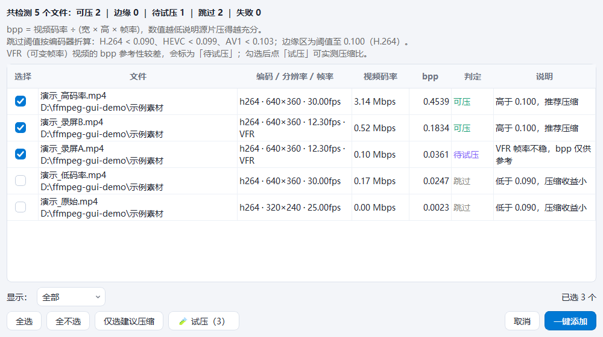

# FFmpeg GUI 批量处理工具

一个基于 PyQt5 的 FFmpeg 图形化批处理工具，把常用的 FFmpeg 命令行操作封装成可视化界面。支持批量截取、合并、字幕封装、音频提取、索引修复、轨道管理、H.265 压缩等场景，无编码操作全程 `-c copy`，画面零损失。压缩前还会用 bpp 指标先判断"值不值得压"，避免对已经压干的片子做二次编码。


## ✨ 功能特性

| 功能 | 说明 | 速度 |
|------|------|------|
| 无编码截取视频 | 按时间点裁剪，支持只填开始 / 只填结束 / 两者都填 | ⚡ 极快 |
| 无编码合并视频 | 多个视频按列表顺序拼接 | ⚡ 极快 |
| 字幕封装 | 把外挂字幕作为**新增字幕轨**追加，原有字幕轨完整保留 | ⚡ 极快 |
| 音频提取 | 从视频中提取音轨 | ⚡ 极快 |
| 修复视频索引 | Remux 重写容器，修复播放异常、拖进度条卡顿 | ⚡ 极快 |
| 轨道管理 | 查看并删除不需要的音轨 / 字幕轨，全程 `-c copy` | ⚡ 极快 |
| 极简压缩 | H.265 + CRF，可自定义质量，输出兼容苹果设备的 `hvc1` | 🐢 较慢 |
| 智能压缩 | 先用 bpp（每像素每帧比特数）判断冗余度；VFR 录屏可抽样试压实测压缩比，再批量压缩 | 🐢 较慢 |
| 视频转码 MP4 | H.264 + AAC 通用格式转换 | 🐢 较慢 |
| 硬件加速 | 自动检测 NVENC / Intel QSV，勾选互斥，未检测到则只用 CPU | — |
| 批量处理 | 支持多选文件、整个文件夹递归扫描、拖拽添加 | — |
| 媒体信息查询 | 调用 ffprobe 查看编码、分辨率、时长、码率 | — |
| 冗余度扫描 | 对比容器码率与音视频流码率之和，排查封装垃圾数据 | — |
| 任务控制 | 处理中随时暂停 / 继续 / 强制停止，停止后自动清理半成品 | — |
| 崩溃自动重试 | ffmpeg 进程异常退出时自动重试 1 次（间隔 3 秒），并抑制 Windows 崩溃弹窗 | — |
| 结果汇总 | 结束后统计成功 / 失败 / 中止 / 重试成功，列出失败文件与返回码含义 | — |
| 日志落盘 | 界面日志实时写入程序目录的 `ffmpeg-gui.log`，带时间戳、单文件 10MB 循环截断 | — |
| 安全退出 | 处理中关闭窗口会二次确认，避免误终止任务 | — |
| 自动关机 | 本轮任务跑完后可自动关机（60 秒倒计时，可取消），适合挂机压片 | — |
| 日志跟随 | 向上翻阅历史日志时不被打断，滚回底部后自动恢复跟随最新行 | — |

## 📸 界面预览

界面统一为圆角卡片风格，主题色 `#0078D4`，按钮 / 输入框 / 列表 / 进度条共用同一套圆角与边框。


### 智能压缩（bpp 预筛）

先算出每个文件的 bpp，再按编码器折算出的阈值给出「可压 / 边缘 / 跳过」判定，默认只勾选建议压缩的文件。



### 轨道管理

查看每条音轨 / 字幕轨的编码、语言、声道与默认标记，勾选要保留的轨道后直接无编码重封装。


## 🔧 环境要求

- **操作系统**：Windows（其他系统理论可用，需自行适配 `os.startfile` 等调用）
- **Python**：3.10 及以上（仅源码运行需要）
- **FFmpeg**：需要已安装并加入系统 PATH（程序启动时会检测并提示）

### 安装 FFmpeg

1. 从 [ffmpeg.org](https://ffmpeg.org/download.html) 或 [gyan.dev](https://www.gyan.dev/ffmpeg/builds/) 下载 Windows 构建版
2. 解压后把 `bin` 目录（包含 `ffmpeg.exe`、`ffprobe.exe`、`ffplay.exe`）加入系统环境变量 `PATH`
3. 命令行执行 `ffmpeg -version` 验证是否可用

## 🚀 快速开始

### 方式一：直接运行源码

```bash
# 1. 克隆仓库
git clone https://github.com/normally4680/ffmpeg-gui.git
cd ffmpeg-gui

# 2. 创建虚拟环境
python -m venv venv
venv\Scripts\activate

# 3. 安装依赖
pip install -r requirements.txt

# 4. 运行
python main.py
```

### 方式二：使用打包好的 exe

前往 [Releases](https://github.com/normally4680/ffmpeg-gui/releases) 页面下载：

- `ffmpeg-gui-single.zip`：单文件版，解压得到 `ffmpeg-gui-single.exe`，双击即用
- `ffmpeg-gui-folder.zip`：目录版，启动更快，适合长期使用

两个版本都无需安装 Python，但**仍需系统里已安装 FFmpeg 并加入 PATH**。

## 📖 使用说明

### 批量截取视频

1. 点击「添加文件 / 添加文件夹」或直接拖入文件、文件夹
2. 处理模式选择「无编码截取视频 (极速)」
3. 勾选「从」填写起始时间，勾选「到」填写结束时间
   - 只勾「到」：从头截到指定时间
   - 只勾「从」：从指定时间截到结尾
   - 两者都勾：截取中间片段
4. 设置输出目录和文件名后缀
5. 点击「开始批量处理」

> 输出文件名后缀不能为空，避免输出文件与源文件同名导致覆盖。

### 合并视频

1. 按期望的合并顺序依次添加视频文件
2. 处理模式选择「无编码合并视频 (极速)」
3. 点击「开始批量处理」，输出文件名以第一个文件为基准

> ⚠️ 无编码合并要求所有视频的编码参数（分辨率、帧率、编码器）一致，否则会失败或音画不同步。可用「视频转码」先统一格式。

### 极简压缩

1. 处理模式选择「极简压缩 (H.265, CRF23)」
2. 按需调整 CRF（18–35，数值越小画质越好、体积越大；23–24 为推荐区间）
3. 需要更快速度时勾选「Nvidia 硬编」或「Intel 硬编」（两者互斥，仅有对应硬件时才可勾选）
4. 勾选「智能音频控制」时，程序会读取源音频码率：≤192 kbps 直接复制，>192 kbps 才转码为 192 kbps AAC

> 输出统一为 MP4 + `hvc1` 标签，可在 iPhone / Mac 上正常播放。

### 智能压缩（bpp 预筛）

对已经压过一遍的片子再压一次 H.265，往往体积只掉一点点，却要花掉一整轮编码时间。这个模式先用 **bpp** 判断源片是不是已经"压干"：

```
bpp = 视频码率(bps) ÷ (宽 × 高 × 帧率)
```

例如 1080p30、5 Mbps 的 H.264 片子，bpp ≈ 0.080，再压收益很小。

**流程**

1. 处理模式选择「智能压缩 (bpp 预筛)」，把要检测的文件加进列表
2. 点「开始批量处理」——此时不压缩，先逐个 ffprobe 计算 bpp（进度条与暂停 / 停止按钮照常可用）
3. 检测结果弹窗列出每个文件的编码 / 分辨率 / 帧率、视频码率、bpp 与判定，**默认只勾选「可压」**，边缘和跳过的文件可以手动勾选
4. VFR 文件标为「待试压」，可以点「试压」实测压缩比（见下节）
5. 点「一键添加」，列表会被替换为勾选的文件
6. 再点一次「开始批量处理」，才真正执行压缩（`libx265` + 可选 CRF + 智能音频，输出 MP4 / `hvc1`）

**判定阈值**（按源编码器折算，数字越小越倾向跳过）

| 源编码 | 跳过阈值 | 边缘区上限 |
|---|---|---|
| H.264 | < 0.090 | 0.100 |
| HEVC / VP9 | < 0.099 | 0.110 |
| AV1 | < 0.104 | 0.115 |
| VP8 | < 0.095 | 0.105 |
| MPEG-4 / Xvid | < 0.077 | 0.085 |
| MPEG-2 | < 0.068 | 0.075 |
| MPEG-1 / H.263 / WMV | < 0.063 | 0.070 |
| ProRes / DNxHD / FFV1 / RAW | 一律视为可压 | — |

高效编码器（HEVC、AV1）同画质只需更少码率，所以阈值上调、更倾向跳过；低效编码器（MPEG-2 等）码率虚高，阈值下调、更倾向压缩。另外，若源文件的 `encoder` 标签显示它本来就是 x265 压出来的，会再乘 1.15 惩罚系数，基本直接判跳过。

**说明**

- 这个模式固定用 CPU（`libx265`），不显示 Nvidia / Intel 硬编选项，避免硬件编码器在大码率片上的质量波动
- 跳过的文件**只记日志、不移动源文件**，检测清单会完整写进日志
- 视频码率取不到时（如部分 MKV），会先尝试"总码率减去音频"，再退到"文件大小 × 8 ÷ 时长"，并在这条记录上标注来源
- 纯音频、损坏文件、无有效帧率等情况会列进弹窗但置灰，并注明原因
- CRF 默认 22（极简压缩是 23），可调范围 18–35

**VFR 录屏与抽样试压**

Xbox Game Bar、部分录屏工具输出的是可变帧率（VFR）：画面静止时丢帧，帧率那一栏可能是 41.81 这种非标准值。bpp 用帧率做分母，这类素材会被**低估** —— 明明还能压掉 80%，却因为 bpp 偏低被判跳过。

程序的处理方式：

- 检测时同时读 `r_frame_rate` 与 `avg_frame_rate`，两者相差超过 2% 即判为 VFR（也避免 `29.97` 与 `30000/1001` 这种舍入误差误报）
- VFR 且 bpp 偏低的文件判为「待试压」（紫色），**不参与默认勾选**，说明栏提示「bpp 仅供参考」
- 点「🧪 试压」可以对**所有 VFR 文件 + 你手动勾选的文件**抽样试压：按正式压缩参数压两段 6 秒短片（片长 25% 与 75% 处，避开开头静止画面），按比例外推全片体积
- 预计省 25% 以上 → 判定改为「可压」并自动勾选；不到 25% → 改为「跳过」；比源文件还大 → 提示建议跳过
- 试压过程的命令行、每段统计（体积 / 速度）、估算结果都会写进日志，同时落盘到 `ffmpeg-gui.log`

压缩时，VFR 文件会自动把帧率规整为固定值，目标值按平均帧率推导：`<24.5 → 24`、`<27 → 25`、`<45 → 30`、`<55 → 50`、否则 `60`。这样既消除 VFR 时间轴抖动、提升播放器兼容性，也顺手丢掉重复帧。若 ffmpeg 版本低于 5.0（没有 `-fps_mode`），会自动退化成只加 `-r`。

### 删除音轨 / 字幕轨

1. 处理模式选择「轨道管理 (删除音轨/字幕轨)」
2. 在列表中**只选中一个文件**，右侧「轨道管理…」按钮亮起（未选中时为灰色不可点）
3. 点开弹窗，勾选要**保留**的轨道，取消勾选即删除
4. 点击「开始批量处理」执行无编码重封装

弹窗内会显示每条轨道的编码、语言、声道 / 码率以及 `default`、`forced` 标记，并处理以下情况：

- 目标容器装不下的字幕编码（例如 MP4 里的 srt / ass）会自动取消勾选并禁用，避免执行时报错
- 删掉的正好是默认轨时，自动把剩下的第一条同类型轨设为默认
- MKV 的字体等附件（ASS 字幕依赖）会随轨道一起保留
- 删光音频会二次确认，防止误操作输出无声视频

> 该模式一次只处理选中的单个文件，不会对列表里的其他文件生效。

### 查看处理结果

批量处理结束后，日志末尾会输出汇总：

```
📊 处理汇总
计划 20 个 ｜ ✅ 成功 19 个 ｜ ❌ 失败 1 个 ｜ 🔁 重试成功 3 个

失败清单：
  • xxx_processed.mp4：返回码 3221225501（0xC000001D：进程崩溃：非法指令…），已自动重试 1 次
```

返回码会自动翻译：Windows 崩溃码（如 `0xC000001D` 非法指令）会给出可能原因，`-2 (ENOENT)` 这类负 errno 会还原成"找不到文件或路径"，便于快速判断是参数问题还是硬件 / 文件问题。

### 崩溃自动重试

批量压缩大文件时，ffmpeg 偶发进程级崩溃（内存、驱动或多核调度导致），表现为程序无提示地停住。现在处理方式：

- 启动时关闭 Windows 错误报告弹窗，崩溃不再弹出"已停止工作"卡住队列
- 识别到崩溃码（如 `0xC000001D`、`0xC0000005`）后自动重试 **1 次**，间隔 3 秒
- 普通报错（文件不存在、参数错误等）不重试，避免浪费时间
- 失败或中止产生的半成品文件自动清理，但不会删除源文件，也不会误删上一次生成的成品
- 重试成功的文件会在汇总里单独计数，方便判断硬件是否稳定

### 打开输出文件夹

「打开输出文件夹」会跟随列表里的选中项：

- 选中某个文件：打开它对应的输出目录；如果这个文件还没处理过，会弹窗确认"是否打开它将要输出的目录"，点取消则不会打开
- 正在处理的文件：直接打开，不弹确认
- 选中多个：以当前焦点那一项（最后点选的那条）为准
- 一个都没选：回退到「输出设置」中的目录；若勾选了"输出到源文件所在目录"，则使用列表第一个文件的所在目录

### 日志文件

日志框里的所有内容会同时写入程序所在目录的 `ffmpeg-gui.log`：

- 每行带 `[YYYY-MM-DD HH:MM:SS]` 时间戳，每次启动写入一行分隔标记
- 只有一个文件，上限 10MB；超出后保留最后 5MB、丢弃最早内容，不会生成 `.1` 之类的备份
- 程序目录不可写时（例如安装在 Program Files），自动改写到 `%LOCALAPPDATA%\ffmpeg-gui\`
- 处理中直接关闭窗口会二次确认，确认后终止 ffmpeg 进程并清理半成品
- 界面最多保留 3000 行，超出后丢弃最早的（只影响界面，落盘文件按 10MB 轮转独立管理）

**滚动行为**：默认贴着最新一行走；一旦你向上翻阅历史日志，新日志进来时不会把视图拽回底部；滚回底部后自动恢复跟随。

**进度行格式**：ffmpeg 的统计行会去掉等号后的补齐空格，例如

```
frame=11 fps=0.0 q=30.0 size=0KiB time=00:00:02.04 bitrate=0.2kbits/s dup=1 drop=0 speed=3.97x
```

### 任务完成后自动关机

挂机压片时可以在日志框下方勾选「任务完成后自动关机（60 秒倒计时，可取消）」：

- **开始前勾选**或**处理中勾选**都可以；若此时任务还在跑，会等这一轮结束再执行
- 执行的是 `shutdown /s /t 60`，Windows 会先弹系统提示，60 秒后才真正关机
- 期间可在收尾弹窗点「🛑 取消关机」，或命令行执行 `shutdown /a` 撤销
- 手动停止、一个任务都没跑、或处理中直接关窗口时**不会**关机
- 一次性生效：本轮结束自动取消勾选，不会带到下一次
- 任务若一直暂停着不会触发，需恢复并跑完

## 📁 项目结构

```
ffmpeg-gui/
├── main.py              # 主程序（界面 + 任务生成 + 线程）
├── requirements.txt     # 依赖清单
├── screenshots/         # 界面截图
├── ffmpeg-gui.log       # 运行时自动生成（最大 10MB）
└── README.md
```

## 🧱 技术栈

- **GUI**：[PyQt5](https://pypi.org/project/PyQt5/) — 跨平台桌面应用框架
- **子进程调用**：Python 标准库 `subprocess` + `QThread` 异步执行，避免界面卡死
- **媒体探测**：`ffprobe` 输出 JSON，解析后展示轨道、时长与码率信息
- **进程控制**：`psutil` 在 Windows 底层挂起 / 恢复 ffmpeg 进程，实现暂停与继续

## 📦 打包为 exe

```bash
pip install pyinstaller

# 单文件版（必须带 --add-data，否则打包后图标资源会丢失）
pyinstaller -F -w --icon=app.ico --add-data "app.ico;." --name ffmpeg-gui main.py

# 目录版（启动更快，便于排查缺库）
pyinstaller -w --icon=app.ico --add-data "app.ico;." --name ffmpeg-gui main.py
```

产物位于 `dist/` 目录。推荐使用**目录模式**（不加 `-F`）获得更快的启动速度；单文件版便于分发。

### 自动构建与发布

仓库已配置 GitHub Actions：推送形如 `v1.6.0` 的 tag 时，会自动在 `windows-latest` 上构建单文件版与目录版两个 ZIP，并创建对应的 Release。也可以在 Actions 页面手动触发。

## 🗺️ 路线图

- [x] 批量截取、合并、字幕封装、音频提取
- [x] 视频索引修复（Remux）
- [x] 文件夹递归扫描与拖拽添加
- [x] 媒体信息查询、冗余度扫描
- [x] 极简压缩（H.265 / 硬件加速 / 自定义 CRF）
- [x] 暂停、继续与强制停止
- [x] 轨道管理（删除音轨 / 字幕轨）
- [x] 处理结果汇总与失败清单
- [x] 崩溃自动重试（仅进程崩溃，1 次）
- [x] 日志落盘（10MB 循环）与安全退出确认
- [x] 智能压缩（bpp 预筛，按编码器折算阈值）
- [x] 界面统一圆角卡片风格与主题色
- [x] VFR 识别与抽样试压（按 avg 帧率推导并规整帧率）
- [x] 任务完成后自动关机（60 秒可取消）
- [x] 日志粘性滚动与进度行格式规整
- [ ] 一键重试失败项
- [ ] 轨道保留规则批量套用到多个文件
- [ ] 试压采样长度可调（大文件想更快时用 4 秒单段）

## 🤝 贡献

欢迎提交 Issue 和 Pull Request！

1. Fork 本仓库
2. 新建分支：`git checkout -b feature/your-feature`
3. 提交改动：`git commit -m "Add: your feature"`
4. 推送分支：`git push origin feature/your-feature`
5. 在 GitHub 上发起 Pull Request

## 📄 许可证

本项目基于 [MIT License](LICENSE) 开源。

## 🙏 致谢

- [FFmpeg](https://ffmpeg.org/) — 强大的多媒体处理工具
- [PyQt5](https://www.riverbankcomputing.com/software/pyqt/) — Python 的 Qt 绑定

---

**如果这个项目对你有帮助，欢迎点个 ⭐ Star！**
