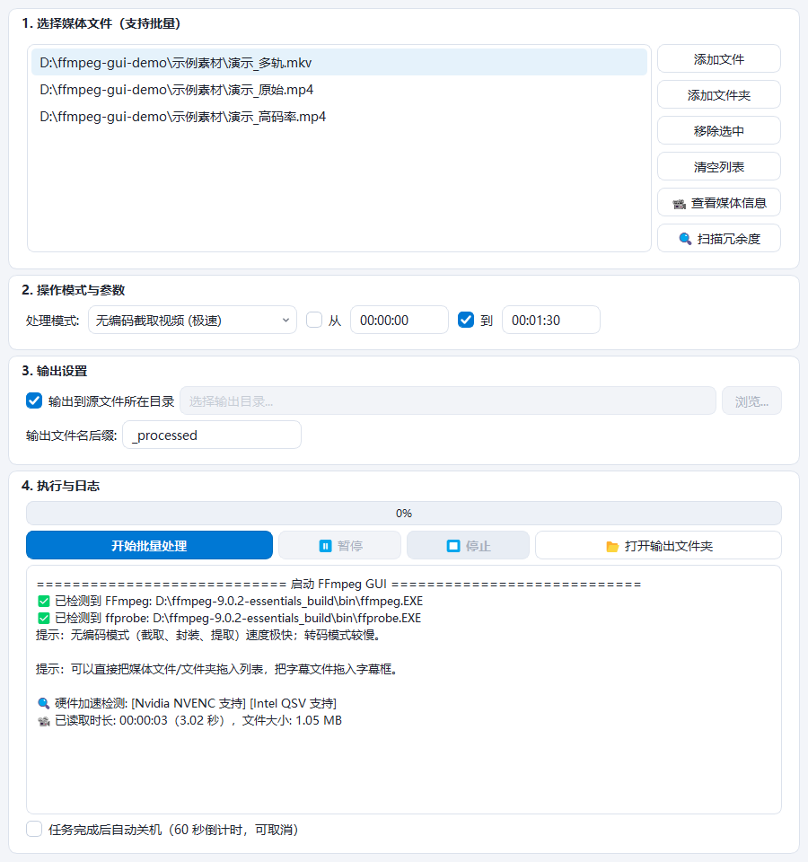
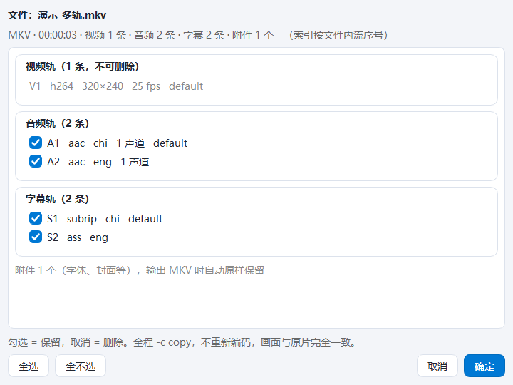

# FFmpeg GUI 批量处理工具

一个基于 PyQt5 的 FFmpeg 图形化批处理工具，把常用的 FFmpeg 命令行操作封装成可视化界面。支持批量截取、合并、字幕封装、音频提取、索引修复、轨道管理、H.265 压缩等场景，无编码操作全程 `-c copy`，画面零损失。


## ✨ 功能特性

| 功能 | 说明 | 速度 |
|------|------|------|
| 无编码截取视频 | 按时间点裁剪，支持只填开始 / 只填结束 / 两者都填 | ⚡ 极快 |
| 无编码合并视频 | 多个视频按列表顺序拼接 | ⚡ 极快 |
| 字幕封装 | 把外挂字幕作为**新增字幕轨**追加，原有字幕轨完整保留 | ⚡ 极快 |
| 音频提取 | 从视频中提取音轨 | ⚡ 极快 |
| 修复视频索引 | Remux 重写容器，修复播放异常、拖进度条卡顿 | ⚡ 极快 |
| 轨道管理 | 查看并删除不需要的音轨 / 字幕轨，全程 `-c copy` | ⚡ 极快 |
| 极简压缩 | H.265 + CRF，可自定义质量，输出兼容苹果设备的 `hvc1` | 🐢 较慢 |
| 视频转码 MP4 | H.264 + AAC 通用格式转换 | 🐢 较慢 |
| 硬件加速 | 自动检测 NVENC / Intel QSV，勾选互斥，未检测到则只用 CPU | — |
| 批量处理 | 支持多选文件、整个文件夹递归扫描、拖拽添加 | — |
| 媒体信息查询 | 调用 ffprobe 查看编码、分辨率、时长、码率 | — |
| 冗余度扫描 | 对比容器码率与音视频流码率之和，排查封装垃圾数据 | — |
| 任务控制 | 处理中随时暂停 / 继续 / 强制停止，停止后自动清理半成品 | — |
| 结果汇总 | 结束后统计成功 / 失败 / 中止，列出失败文件、返回码含义与半成品路径 | — |

## 📸 界面预览



### 轨道管理

查看每条音轨 / 字幕轨的编码、语言、声道与默认标记，勾选要保留的轨道后直接无编码重封装。



## 🔧 环境要求

- **操作系统**：Windows（其他系统理论可用，需自行适配 `os.startfile` 等调用）
- **Python**：3.10 及以上（仅源码运行需要）
- **FFmpeg**：需要已安装并加入系统 PATH（程序启动时会检测并提示）

### 安装 FFmpeg

1. 从 [ffmpeg.org](https://ffmpeg.org/download.html) 或 [gyan.dev](https://www.gyan.dev/ffmpeg/builds/) 下载 Windows 构建版
2. 解压后把 `bin` 目录（包含 `ffmpeg.exe`、`ffprobe.exe`、`ffplay.exe`）加入系统环境变量 `PATH`
3. 命令行执行 `ffmpeg -version` 验证是否可用

## 🚀 快速开始

### 方式一：直接运行源码

```bash
# 1. 克隆仓库
git clone https://github.com/normally4680/ffmpeg-gui.git
cd ffmpeg-gui

# 2. 创建虚拟环境
python -m venv venv
venv\Scripts\activate

# 3. 安装依赖
pip install -r requirements.txt

# 4. 运行
python main.py
```

### 方式二：使用打包好的 exe

前往 [Releases](https://github.com/normally4680/ffmpeg-gui/releases) 页面下载：

- `ffmpeg-gui-single.zip`：单文件版，解压得到 `ffmpeg-gui-single.exe`，双击即用
- `ffmpeg-gui-folder.zip`：目录版，启动更快，适合长期使用

两个版本都无需安装 Python，但**仍需系统里已安装 FFmpeg 并加入 PATH**。

## 📖 使用说明

### 批量截取视频

1. 点击「添加文件 / 添加文件夹」或直接拖入文件、文件夹
2. 处理模式选择「无编码截取视频 (极速)」
3. 勾选「从」填写起始时间，勾选「到」填写结束时间
   - 只勾「到」：从头截到指定时间
   - 只勾「从」：从指定时间截到结尾
   - 两者都勾：截取中间片段
4. 设置输出目录和文件名后缀
5. 点击「开始批量处理」

> 输出文件名后缀不能为空，避免输出文件与源文件同名导致覆盖。

### 合并视频

1. 按期望的合并顺序依次添加视频文件
2. 处理模式选择「无编码合并视频 (极速)」
3. 点击「开始批量处理」，输出文件名以第一个文件为基准

> ⚠️ 无编码合并要求所有视频的编码参数（分辨率、帧率、编码器）一致，否则会失败或音画不同步。可用「视频转码」先统一格式。

### 极简压缩

1. 处理模式选择「极简压缩 (H.265, CRF23)」
2. 按需调整 CRF（18–35，数值越小画质越好、体积越大；23–24 为推荐区间）
3. 需要更快速度时勾选「Nvidia 硬编」或「Intel 硬编」（两者互斥，仅有对应硬件时才可勾选）
4. 勾选「智能音频控制」时，程序会读取源音频码率：≤192 kbps 直接复制，>192 kbps 才转码为 192 kbps AAC

> 输出统一为 MP4 + `hvc1` 标签，可在 iPhone / Mac 上正常播放。

### 删除音轨 / 字幕轨

1. 处理模式选择「轨道管理 (删除音轨/字幕轨)」
2. 在列表中**只选中一个文件**，右侧「轨道管理…」按钮亮起（未选中时为灰色不可点）
3. 点开弹窗，勾选要**保留**的轨道，取消勾选即删除
4. 点击「开始批量处理」执行无编码重封装

弹窗内会显示每条轨道的编码、语言、声道 / 码率以及 `default`、`forced` 标记，并处理以下情况：

- 目标容器装不下的字幕编码（例如 MP4 里的 srt / ass）会自动取消勾选并禁用，避免执行时报错
- 删掉的正好是默认轨时，自动把剩下的第一条同类型轨设为默认
- MKV 的字体等附件（ASS 字幕依赖）会随轨道一起保留
- 删光音频会二次确认，防止误操作输出无声视频

> 该模式一次只处理选中的单个文件，不会对列表里的其他文件生效。

### 查看处理结果

批量处理结束后，日志末尾会输出汇总：

```
📊 处理汇总
计划 7 个 ｜ ✅ 成功 6 个 ｜ ❌ 失败 1 个

失败清单：
  • xxx_processed.mp4：返回码 3221225501（0xC000001D：进程崩溃：非法指令…）
    半成品已保留（不能当成品使用）：D:\...\xxx_processed.mp4
```

返回码会自动翻译：Windows 崩溃码（如 `0xC000001D` 非法指令）会给出可能原因，`-2 (ENOENT)` 这类负 errno 会还原成"找不到文件或路径"，便于快速判断是参数问题还是硬件 / 文件问题。

## 📁 项目结构

```
ffmpeg-gui/
├── main.py              # 主程序（界面 + 任务生成 + 线程）
├── requirements.txt     # 依赖清单
├── screenshots/         # 界面截图
└── README.md
```

## 🧱 技术栈

- **GUI**：[PyQt5](https://pypi.org/project/PyQt5/) — 跨平台桌面应用框架
- **子进程调用**：Python 标准库 `subprocess` + `QThread` 异步执行，避免界面卡死
- **媒体探测**：`ffprobe` 输出 JSON，解析后展示轨道、时长与码率信息
- **进程控制**：`psutil` 在 Windows 底层挂起 / 恢复 ffmpeg 进程，实现暂停与继续

## 📦 打包为 exe

```bash
pip install pyinstaller

# 单文件版（必须带 --add-data，否则打包后图标资源会丢失）
pyinstaller -F -w --icon=app.ico --add-data "app.ico;." --name ffmpeg-gui main.py

# 目录版（启动更快，便于排查缺库）
pyinstaller -w --icon=app.ico --add-data "app.ico;." --name ffmpeg-gui main.py
```

产物位于 `dist/` 目录。推荐使用**目录模式**（不加 `-F`）获得更快的启动速度；单文件版便于分发。

### 自动构建与发布

仓库已配置 GitHub Actions：推送形如 `v1.2.0` 的 tag 时，会自动在 `windows-latest` 上构建单文件版与目录版两个 ZIP，并创建对应的 Release。也可以在 Actions 页面手动触发。

## 🗺️ 路线图

- [x] 批量截取、合并、字幕封装、音频提取
- [x] 视频索引修复（Remux）
- [x] 文件夹递归扫描与拖拽添加
- [x] 媒体信息查询、冗余度扫描
- [x] 极简压缩（H.265 / 硬件加速 / 自定义 CRF）
- [x] 暂停、继续与强制停止
- [x] 轨道管理（删除音轨 / 字幕轨）
- [x] 处理结果汇总与失败清单
- [ ] 一键重试失败项
- [ ] 轨道保留规则批量套用到多个文件

## 🤝 贡献

欢迎提交 Issue 和 Pull Request！

1. Fork 本仓库
2. 新建分支：`git checkout -b feature/your-feature`
3. 提交改动：`git commit -m "Add: your feature"`
4. 推送分支：`git push origin feature/your-feature`
5. 在 GitHub 上发起 Pull Request

## 📄 许可证

本项目基于 [MIT License](LICENSE) 开源。

## 🙏 致谢

- [FFmpeg](https://ffmpeg.org/) — 强大的多媒体处理工具
- [PyQt5](https://www.riverbankcomputing.com/software/pyqt/) — Python 的 Qt 绑定

---

**如果这个项目对你有帮助，欢迎点个 ⭐ Star！**
